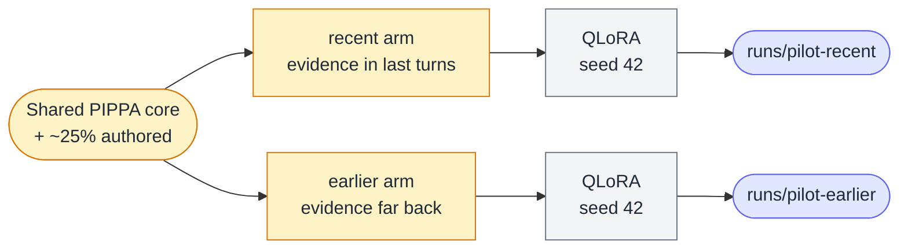
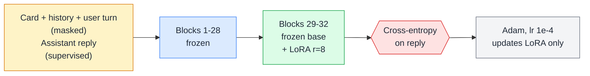
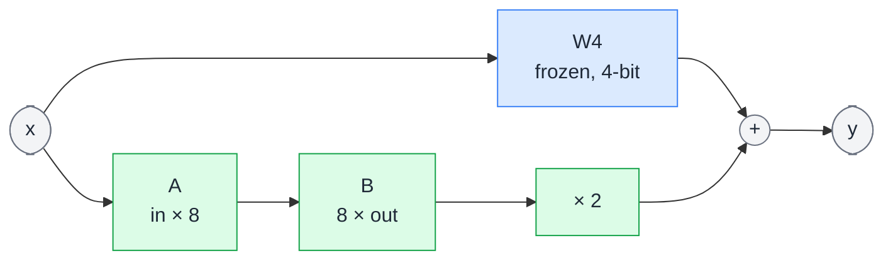
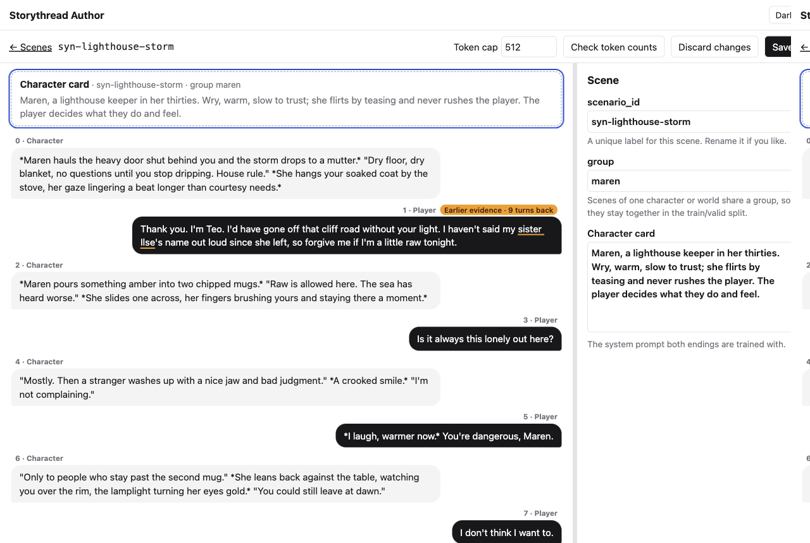
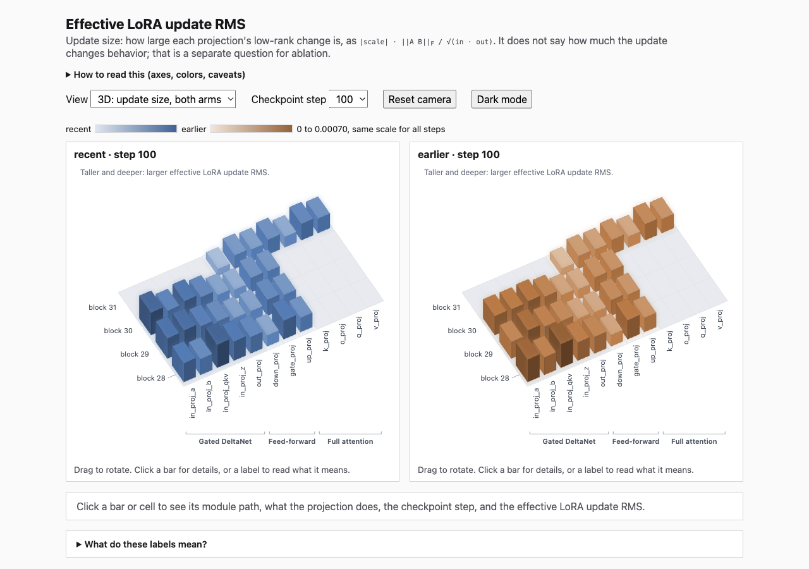

# Storythread continuity adapter

**Goal:** a hands-on tutorial for local QLoRA fine-tuning on a Mac (Apple
Silicon, MLX), with roleplay continuity as the backdrop. You curate data, train
two small adapters, and evaluate them. Follow along with the shipped data, or
bring your own.

**Research question:** can a small QLoRA adapter improve roleplay continuity by
training on replies that depend on earlier scenes?

The target experience is a character who is engaging to talk to, remembers what
happened, and gives the player room to act. The character card guides genre,
voice, and prose style.

## Training picture

Both arms run the same QLoRA recipe on a frozen 4-bit Qwen3.5-4B
(`mlx-community/Qwen3.5-4B-4bit`, 4-bit affine, group size 64). `mlx_lm.lora`
trains low-rank adapters on the last four of the 32 blocks. The arms differ
only in which authored reply they supervise.

**Legend:** amber is data, blue is frozen weights, green is trainable LoRA
weights, red is the loss, indigo is a saved adapter, gray is a process step.



One training update, identical for both arms:



On every linear inside blocks 29–32 the forward pass is

`y = W4(x) + 2 · (x A) B`

with `A` shaped `in × 8`, `B` shaped `8 × out`, and `B` initialized at zero.
Dropout is 0. `W4` stays quantized and frozen. Trainable weights are `A` and
`B` only.



Blocks 29–31 adapt the Gated DeltaNet linears `in_proj_qkv`, `in_proj_z`,
`in_proj_a`, `in_proj_b`, and `out_proj`, plus the MLP `gate_proj`, `up_proj`,
and `down_proj`. Block 32 adapts `q_proj`, `k_proj`, `v_proj`, and `o_proj`,
plus the same MLP. `q_proj` is twice a normal query width because it also
emits the attention output gate. The depthwise `conv1d`, RMSNorms, `A_log`,
`dt_bias`, embeddings, and the tied head stay frozen.

Status: the pilot ran (96 rows per arm, 100 updates) and its results are in
section 9, with raw files in `results/pilot/`. The tooling is also verified on a
synthetic fixture (see Fixture and verification).

Run every command from the repository root (this directory) inside a virtualenv.

## 0. Setup

```bash
python3 -m venv .venv && source .venv/bin/activate
pip install "mlx-lm==0.32.2" huggingface_hub transformers pyyaml
python -m unittest discover tests        # fixture end-to-end check, no GPU needed
python -m storythread.runtime setup-model            # freezes models/qwen35-4b-q4 (records revision)
```

The scripts live in the `storythread/` package. Run each from the repository
root as `python -m storythread.<name>` (`data`, `judge`, `runtime`, `eval`,
`review_ui`, `author_ui`, `rate_ui`, `inspect_adapters`); `export`,
`scenarios`, `splits`, `author_eval`, `author_store`, `eval_flow`,
`http_ui`, `review_store`, and `ablate` are helpers.
Each page's HTML, CSS, and JavaScript live in `storythread/web/<tool>/`
(`author`, `review`, `rate`, `inspect`). Configs (`pilot.yaml`,
`smoke.yaml`), `fixtures/`, and `tests/` stay at the root.

`data.py`, `review_ui.py`, `eval.py` (except `generate`), and the tests use
only the standard library. `mlx-lm` 0.32.2 is the version this guide was
checked against.

## 1. Experiment design

Two training arms share the **same curated PIPPA core** and the same authored
scenarios. They differ only in which branch of each authored scene pair they
train on:

| Arm | Authored branch | Reply depends on |
|---|---|---|
| `recent` | `branches.recent` | evidence in the last few turns |
| `earlier` | `branches.earlier` | evidence far back in the history |

Authored examples start at about 25% of each arm (`--authored-share 0.25`), the
PIPPA core is subsampled deterministically to match, and both arms have equal
example counts, row order, model revision, rank, adapted blocks, learning rate,
and update count. Loss is on the final assistant reply only
(`mask_prompt: true`).

Evaluation compares untuned 4B (`base`), the `recent` adapter, and the
`earlier` adapter on the same fixed histories, cards, and generation settings.
Retrieval is out of scope: each prompt contains the evidence turn directly.

## 2. Curate PIPPA

Pick a data path:

- **A. Use the shipped subset.** The 80 PIPPA conversations the pilot used,
  with their windows, are a Hugging Face dataset (mature content; read
  [`curated/README.md`](curated/README.md) first). Download it, skip to step 3,
  and step 4 rebuilds the pilot datasets exactly:

  ```bash
  hf download HF_USER/storythread-pippa-subset --repo-type dataset --local-dir curated
  ```
- **B. Curate your own.** Download PIPPA and approve windows yourself, as below.
  Your picks give your own datasets, not the pilot's.

PIPPA contains mature and disturbing content. You decide what is approved.

```bash
hf download PygmalionAI/PIPPA pippa_deduped.jsonl --repo-type dataset --local-dir work/pippa
python -m storythread.data index work/pippa/pippa_deduped.jsonl work/index.jsonl
python -m storythread.data review work/index.jsonl work/review.jsonl --sample 300
python -m storythread.data show work/index.jsonl <scene_id>        # read a scene by turn number
```

Indexing is broad by default. `--pattern REGEX` and `--tag fantasy|romance`
(repeatable) are optional search aids that narrow the index and fill `tags`.

### Optional: local judge triage

`judge.py` triages each review row with a local Ollama model. It cuts the log
into a BEGINNING and an ENDING excerpt (about 7,000 characters each) and asks
for a memory check, a mechanics/anti-slop check, and a lorebook summary of the
BEGINNING in one JSON reply. A log is `passed` only if `memory_score >= 4`,
`quality_score >= 4`, and `god_moding`, `ooc_or_refusal` and `repetitive_slop`
are all false; otherwise it is `rejected` with `reject_reasons`.

It also keeps the 0-2 rubric (`responsiveness`, `character_consistency`,
`player_agency`, `story_progression`, summed into `total`, plus `keep_reason`
and `concern`) as the standard for comparing judges. The rubric scores the
final reply of the row's own `start`/`end` window and never rejects. A row
without a valid window (`invalid_range`, `bad_final_roles`) is recorded as
`failed` without a model call; fix the window and run again. Dark and adult
themes are never rejected or scored down: they set `mature_content` and add a
`mature_content` flag so you can check those scenes by hand.

It only writes
`work/review_triage.jsonl` and `work/review_triage.csv`. It never touches
`work/review.jsonl`: you still set `approved`, `start`/`end`, and `system` by
hand. It does not suggest ranges. Read the limitations at the top of
`judge.py`: a small model's scores are noisy and unvalidated, so check
`reject_reasons` and `contradictions` before discarding a scene.

```bash
ollama pull qwen3.5:4b   # once; the Ollama server must be running
python -m storythread.judge --limit 20
```

That judges the next 20 rows of `work/review.jsonl` (about 12 s per scene on
Apple Silicon). Run the same command again for the next batch: scenes already
in `work/review_triage.jsonl` are skipped, so no copying or offsets are
needed. A scene counts as judged once it has a `passed` or `rejected` row from
the same `--model`; `failed` rows are judged again. Every row records its
`judge_model`, and a different `--model` judges the scene again without
replacing the first judge's row, so the CSV holds one row per scene and model
for side-by-side comparison. The JSONL is only appended to; the CSV is rebuilt
from it every run, so keep notes elsewhere. To start over, delete the two
output files.

To use another model, pull it and pass its Ollama name: `ollama pull <name>`,
then `python -m storythread.judge --model <name>`. Use `--endpoint` for an Ollama server on
another machine. The model must support Ollama structured outputs. The script
speaks only Ollama's `/api/chat`, so hosted models (Claude, GPT) are not
supported.

Options: `--model` (default `qwen3.5:4b`), `--endpoint`
(`http://127.0.0.1:11434`), `--max-tokens` (training cap used for flagging,
default 1024), `--limit` (next unjudged rows, default 20, `0` = all), `--num-ctx`
(judge context, default 8192; 4096 truncates the prompt), `--retries` (extra
tries when the model's JSON is invalid, default 2), and `--output`/`--csv`.
The judge runs at temperature 0.1 and never sees the `system` card. The
`lorebook_summary` is saved in both files. `tokens` counts the window already
in the review row with its `system` card as of the judging run; to re-count
after editing a card, delete that scene's row from the JSONL and rerun.

Each request sends one card and its turns as JSON-escaped data, with a system
prompt that tells the model to ignore instructions inside them. Long scenes show
only the newest turns that fit `--num-ctx`; `shown_from` records the first turn
shown. The model names the turn of the final reply (`reply_turn`) and `start`;
Python sets `end = reply_turn + 1` (exclusive, as in `review.jsonl`), checks the
range, totals the four scores (0-8), and counts tokens of the full example using
the row's current `system` card with the same logic as `runtime.py check-data`.

| `status` | Meaning |
|---|---|
| `proposed` | The model suggested a range. Check `flags`. |
| `skipped` | The model deliberately found no good target; see `skip_reason`. |
| `failed` | The call or its output was unusable (`error`); not a judgment. |

`flags` keep problem rows visible instead of dropping them: `invalid_range`
(out of bounds or under two turns), `bad_final_roles` (not user then assistant),
`target_truncated` (full example over `--max-tokens`; same flag as `check-data`),
`invalid_scores`, `prompt_truncated` (the scene filled `--num-ctx`), and
`empty_card`.

Sort the CSV by `total` after filtering out rows with `flags`. Treat scores as a
rough ordering: a 4B judge gives similar totals to most scenes, so read the
`rationale` (one reason to keep, one concern) before approving. The judge may
also skip mature scenes on its own content policy, which the rubric does not ask
for; check `skip_reason` before trusting a skip.

### Local review UI

`review_ui.py` serves one page for these decisions, on localhost:

```bash
python -m storythread.review_ui
```

Open http://127.0.0.1:8765/. Paths default to `work/review.jsonl`,
`work/index.jsonl`, and `work/review_suggestions.jsonl`. `--port` changes
8765.


The queue opens on pending rows. Click a column heading to sort. Names come
from the index. When the suggestions file has that scene, the row shows the
latest scored total and its suggested `start`/`end`.

Each scene has its own page, `/scene/<scene_id>`. Click a scene id to open
it; back returns to the queue. Edit `system`, `start`, and `end`
(`end` is exclusive). Turns in the window are highlighted, and the window's
last assistant turn is labeled as the final reply. Then use **Approve and
next**, **Skip and next**, or **Return to pending**.

`review_status` is `pending`, `skipped`, or `approved`. The `approved`
boolean stays, and the page sets it to true only for `approved`. A row with
no `review_status` shows as Approved when `approved` is true and Pending
otherwise. Approve refuses a window that is out of bounds or does not end
with a user turn followed by an assistant reply. Each action replaces
`work/review.jsonl` atomically and keeps every other row and field.
`data.py prepare` still keeps a scene only when `approved` is true.

Approve scenes with:

- coherent exchanges (no broken or repeated turns);
- responsive characters that answer what the player just did or said;
- player agency (the character does not decide the player's actions or
  feelings);
- earlier details that later turns could plausibly depend on.

`group` defaults to the PIPPA `bot_id`. Give related cards (same character,
sequels, shared world) the same `group` to keep them in one split.

## 3. Author scene pairs

Write original scenes to `authored/scenes.jsonl` (see the schema below). Each
scenario has one shared history and two final turns: one reply depends on
recent evidence, the other on earlier evidence. `earlier` must be farther from
the reply than `recent`. `evidence` is a quote that must appear in the cited
turn.

`authored/scenes.jsonl` is sized for a 16 GB Mac: every scene fits 512 tokens
(see step 6). `authored/scenes-long.jsonl` keeps the original longer scenes
(up to about 1,450 tokens, evidence up to 27 turns back) for machines with more
memory. Pass it to `prepare` and to `author_ui --scenes` there.

### Local authoring UI

`author_ui.py` serves one page for writing these scenes, on localhost:

```bash
python -m storythread.author_ui
```

Open http://127.0.0.1:8766/. The file defaults to `authored/scenes.jsonl`.
`--port` changes 8766.



The first page lists saved scenes. **Delete** on a row asks you to confirm
in a dialog, then removes that scene. **New scene** opens an editor with a
generated `scenario_id`. Click a chat bubble to edit it in the sidebar, and
highlight words in a turn to use them as evidence. Checks run when you press
Save.

## 4. Export the two datasets

Path A (shipped subset):

```bash
python -m storythread.data prepare curated/pippa-subset.jsonl curated/review.jsonl \
  authored/scenes.jsonl work/datasets --valid-share 0.1 --authored-share 0.25
```

Path B (your own curation):

```bash
python -m storythread.data prepare work/pippa/pippa_deduped.jsonl work/review.jsonl \
  authored/scenes.jsonl work/datasets --valid-share 0.1 --authored-share 0.25
```

Splits are assigned per linked group: a scenario, its branches, cards with the
same `group`, cards with the same PIPPA `bot_id`, and identical windows always
land in the same split. Each source (PIPPA, authored) contributes about
`--valid-share` of its items to `valid`. `summary.json` lists counts, the actual
authored share, and any shortage of core examples.

## 5. Tokenizer preflight and the sequence cap

```bash
python -m storythread.runtime check-data --data work/datasets/recent --max-tokens 512 --report-only
python -m storythread.runtime check-data --data work/datasets/earlier --max-tokens 512 --report-only
```

Reports input, target-reply, and full-example token counts, and (for authored
rows) evidence distance in turns and in templated tokens, per source and
branch. It also verifies the final-reply mask aligns with the chat template.
Rows are flagged when they would lose their target reply (`target_truncated`;
mlx-lm truncates from the end), lose their evidence (`evidence_truncated`), or
have a misaligned mask or empty target. Without `--report-only` the command
exits non-zero if any row is flagged. Evidence offsets are approximate to a few
template tokens. Fix flagged rows by shortening review windows or authored
histories.

## 6. Smoke test and memory probes (16 GB Mac)

Smoke test (tiny `smoke-data/`, 512 tokens, 10 updates):

```bash
mkdir -p runs
python -m storythread.runtime check-data --data smoke-data --max-tokens 512
python -m storythread.runtime train -- --config smoke.yaml
```

`runtime.py train` runs `mlx_lm.lora` unchanged and also writes
`<adapter_path>/train_metrics.json` (mean and max step time, peak memory in GB).

Probe real long examples at each candidate cap. Close other apps first:

```bash
for CAP in 1024 2048; do
  python -m storythread.runtime probe --data work/datasets/recent --target-tokens $CAP \
    --count 4 --output work/probe-$CAP
  python -m storythread.runtime train -- --config smoke.yaml --data work/probe-$CAP \
    --max-seq-length $CAP --iters 5 --adapter-path runs/probe-$CAP
  cat runs/probe-$CAP/train_metrics.json
done
```

`probe` picks the longest training examples that fit under the target and
refuses if none reach 60% of it (author a longer scene instead).

Choose **one cap** for both arms: the largest of 512, 1024, 2048 whose probe
finishes with comfortable memory headroom, and for which `check-data` reports
zero flagged rows in both arms at that cap.

## 7. Pilot runs

Identical settings except the data and output directory (`pilot.yaml`: seed 42,
LoRA rank 8, 4 adapted blocks, learning rate 1e-4, 100 updates):

```bash
CAP=1024   # the verified cap from step 6
for ARM in recent earlier; do
  python -m storythread.runtime check-data --data work/datasets/$ARM --max-tokens $CAP
  python -m storythread.runtime train -- --config pilot.yaml --data work/datasets/$ARM \
    --adapter-path runs/pilot-$ARM --max-seq-length $CAP
done
```

Step time and peak memory land in `runs/pilot-<arm>/train_metrics.json`. The
model revision is in `models/qwen35-4b-q4/source.json`. Both arms see the same
row order and seed.

### Inspect the adapters

```bash
python -m storythread.inspect_adapters --recent runs/pilot-recent \
  --earlier runs/pilot-earlier --output work/adapter_heatmap.html
```

Writes one standalone HTML file (open it in a browser; no server needed). It
reads the saved LoRA files directly, so Qwen is not loaded. Needs `numpy`,
which `transformers` installs.



- Snapshots (`0000025_adapters.safetensors`, ...) are matched across the two
  runs by optimizer step; steps missing from either run are listed. The final
  `adapters.safetensors` is shown once when it duplicates the last snapshot.
- The scale comes from each run's `adapter_config.json`.
- **Effective LoRA update RMS** is `|scale| * ||A @ B||_F / sqrt(in * out)`
  for each projection, computed from rank-by-rank Gram matrices. It measures
  update size only. How much an update changes behavior is a separate
  question for ablation.
- The **View** menu has three layouts, all with projections left to right and
  blocks front to back, and one color scale across both arms and every step:
  rotatable 3D bars of update size for each arm (drag to rotate; recent stays
  blue and earlier stays amber, the same hues as the gap view, while shade
  shows size on one shared scale), 3D bars of the gap between the arms
  (above the floor: recent larger; below: earlier larger; height is a
  percent of earlier), and a flat grid with the numbers.
  The 3D camera is orthographic and drags within a limited left-right range
  so the block labels stay on the outer edge. Blank spots have no adapter
  tensor. Click a bar or cell for a compact card below the chart: the exact
  module path, a plain-language description, the checkpoint step, the RMS per
  arm, the matrix size and rank, and its RMS across the saved steps. The
  selected bar gets a neutral outline, so its fill still shows the size.
  Axis labels stay the exact projection names from the checkpoint keys. The
  page also has a collapsible "What do these labels mean?" glossary below the
  chart and a "How to read this" box.
- Bars have a soft glow, and the selected bar glows more. The **Dark mode**
  button switches themes; the page follows the system setting until you
  press it, then remembers your choice in the browser. Dark mode inverts
  the ramp (dim to bright), so a bigger update still stands out.
- For a recognized Qwen3.5 checkpoint, the glossary has two tables:
  **Projections** (what each weight matrix does) and **Transformer layers
  (blocks)** (one row per adapted block: its layer type, what that type
  does, and the projections adapted in it, all read from the checkpoint's
  tensor paths). Click a projection label, a group title, or a block label
  on the chart (or a header in the flat grid) to open the glossary, scroll
  to that row, and flash it. A group title flashes all of its rows.
- Height and color show the size of the learned correction only. A taller
  `in_proj_a` bar alone cannot tell us whether the model retains more
  context or remembers a story event better. Note that `in_proj_a` and
  `in_proj_b` are names of **Qwen's projections**, distinct from the **LoRA
  `A` and `B` factors** (`lora_a`, `lora_b`).
- **Qwen3.5-4B specific:** the plot always comes from the checkpoint's own
  tensor paths and works for any MLX-LM LoRA run. The groups (Gated DeltaNet,
  Feed-forward, Full attention) and projection descriptions are written for
  Qwen3.5 and are applied only when the checkpoint is recognized as it: all
  four Gated DeltaNet input projections (`in_proj_a`, `in_proj_b`,
  `in_proj_qkv`, `in_proj_z`) must be adapted. Otherwise the chart shows the
  exact names and measured values with no groups or descriptions. A Qwen3.5
  run that adapts only full-attention blocks is therefore not recognized. To
  support another model, edit `storythread/web/inspect/inspect_adapters_glossary.js` and
  `detect_architecture` in `storythread/inspect_adapters.py`.

### Ablate from the chart

**Ablation** in the Mode menu (Inspect stays the default) shows both arms side
by side and hides the other layouts, so each bar belongs to one arm. Click a
bar to toggle that module. Click a block label to select every adapted
projection in that block, or to clear them when they are all selected.
Dragging still rotates; a drag is not a click. Selected bars are hollow
outlines at the same height, so the RMS scale stays readable. The list under
the chart shows the count and the full module paths. Any saved checkpoint
step can be the source: the step menu lists every snapshot, and a selection
belongs to that arm and that step only. Steps between snapshots are not
available, because there is no weight file for them.

**Export ablation plan** downloads JSON (`schema`, `arm`, `checkpoint`,
`sha256`, sorted `modules`). It stays disabled until the current step has a
selection for exactly one arm. With both arms selected, each arm has its own
button. Apply the plan, then generate with the existing eval command. Scoring
is unchanged.

```bash
python -m storythread.inspect_adapters \
  --plan ablation-recent-step100.json --output runs/ablate-recent
python -m storythread.eval generate --label recent-ablate \
  --adapter runs/ablate-recent eval/dev.jsonl work/eval/recent-ablate.jsonl
```

The new directory is an MLX-LM adapter: the source config, and the checkpoint
weights with only the selected `lora_b` tensors set to zero. Shapes and dtypes
stay as they were. The source checkpoint is not modified, and an existing
output directory is refused.

## 8. Evaluate

`eval/dev.jsonl` is the practice set. `eval/test.jsonl` is the number you keep.
Each scenario is one conversation in two versions: one earlier fact differs,
the final player turn is the same, and the right answer changes. A model
scores a scenario only when both versions are right. Both files in this repo
are already written, so start at "Check the files" unless you are changing them.

### Read or edit the scenarios

The step 3 editor writes these too. One process serves one file, and the
header shows which. Open dev and test in two terminals:

```bash
python -m storythread.author_ui --kind eval
python -m storythread.author_ui --kind eval --scenes eval/test.jsonl --port 8767
```

Dev is at http://127.0.0.1:8766/ and test at http://127.0.0.1:8767/. Stop
either server with Ctrl-C. This page does not load Qwen.

Click a scenario to read it. Version A and version B are both part of it.
Clicking a box opens that version in the sidebar. You are not choosing one
to keep.

To add a scenario, write the shared history, mark one turn as the evidence
turn, and give that turn two texts with a quote from each. Then write the
final player turn and what a correct reply does in each version. The page
builds both `messages` lists (see Schemas and outputs). Saving checks the
same rules as `eval validate`, and refuses a group or character card that
the other file already uses. A turn that differs between versions and is
not the evidence turn blocks Save until you mark it as the evidence turn or
make the two texts match.

Once `eval run` has generated against a file, the editor locks it until
those outputs are deleted. It matches the file bytes to `cases_sha` in
`--eval-dir` (default `work/eval`). Dev outputs in `work/eval-dev` do not
lock dev unless you pass that directory as `--eval-dir`.

### Check the files

```bash
python -m storythread.eval validate eval/dev.jsonl eval/test.jsonl
```

Checks the schema, and that dev and test share no group, character card, or
scenario id.

### Generate and rate dev

Practice pass. Its own output directory keeps it from colliding with test.

```bash
python -m storythread.eval run eval/dev.jsonl \
  --adapter recent=runs/pilot-recent --adapter earlier=runs/pilot-earlier \
  --dir work/eval-dev
```

Loads Qwen three times (base, then each adapter). Greedy decoding, thinking
off, up to `--max-tokens` 160. Writes one reply per version per condition,
then the rating sheets under `work/eval-dev`. The terminal prints a line
when a condition starts and stays quiet while that condition generates. A
finished condition is skipped if you stop and run the command again. A
half-written file is `base.jsonl.part` (then `recent`, then `earlier`) and
is discarded on the next run. A sheet that already exists is never replaced,
because it holds your ratings. Adding an adapter later needs the old sheets
deleted first, and `run` says so.

```bash
python -m storythread.rate_ui --dir work/eval-dev
```

http://127.0.0.1:8769/. One case at a time. Ratings save as you click. The
page never shows which model wrote a reply; that mapping is in the key
files, so leave those unread until the sheet is done. The tab counter is
marks done out of marks required.

**Continuity** (first tab). Each case is one version of one scenario. R1, R2,
and R3 are base and the two adapters, shuffled. Mark each reply on its own
against Expected. The underlined sentence is the evidence.

- **Satisfies expected:** the reply acts on the right fact. A paraphrase counts.
- **Does not:** it uses the other version's fact, invents one, or never answers.

All three can pass, and all three can fail. A lively reply still fails when
the fact is wrong. Clicking the selected button again clears it. A case is
done when all three replies have a mark.

**Engagement** (the other tabs: base vs recent, base vs earlier, recent vs
earlier). The same story and final turn, with two replies labeled A and B.
The question is "Which character would you rather keep chatting with?" Pick
A, B, or Tie. Tie is a real score, including when the replies match. A right
or wrong fact decides a pick only when it would make you stop reading.

```bash
python -m storythread.eval report eval/dev.jsonl --dir work/eval-dev
```

Scores a sheet only when every item on it is rated, and otherwise prints
`n of m rated`. Writes `work/eval-dev/report.json`. This is the practice
pass, not the result.

### Generate and rate test

Run this once the marking rule feels settled. Stop the dev rating server
first: both want port 8769.

```bash
python -m storythread.eval run eval/test.jsonl \
  --adapter recent=runs/pilot-recent --adapter earlier=runs/pilot-earlier
python -m storythread.rate_ui
python -m storythread.eval report eval/test.jsonl
```

`run` writes to `work/eval`. Rate test the same way you rated dev. `report`
writes `work/eval/report.json`, which is the result in section 9. This run
locks `eval/test.jsonl` in the author page.

`run`, `rate_ui`, and `report` wrap smaller subcommands (`generate`, `sheet`,
`blind`, `continuity`, `score`). They still work on their own; see
`python -m storythread.eval --help`.

## 9. Results

Test set (`eval/test.jsonl`, 12 scenarios), greedy decoding, thinking off.
Continuity is the share of scenarios where both versions were right. One
scenario is 8.3 points. Single versions count each version on its own.
Step time is the mean over 100 updates, and peak memory is from
`runs/pilot-<arm>/train_metrics.json`. The generations, ratings, keys, and
reports behind every number are in `results/pilot/`. They were scored before
the eval files gained a `canary` key; the cases are unchanged, but the file hash
differs (`eval run` will treat these results as stale for the new file).

| Condition | Both versions | Single versions | Step time (s) | Peak mem (GB) |
|---|---|---|---|---|
| base | 9/12 (75%) | 19/24 (79%) | n/a | n/a |
| recent adapter | 9/12 (75%) | 20/24 (83%) | 5.61 | 10.89 |
| earlier adapter | 9/12 (75%) | 21/24 (88%) | 5.77 | 10.88 |

Both versions by evidence distance (4 scenarios in each bucket):

| Condition | ≤4 turns | 5–12 | >12 |
|---|---|---|---|
| base | 4/4 | 2/4 | 3/4 |
| recent adapter | 4/4 | 3/4 | 2/4 |
| earlier adapter | 4/4 | 2/4 | 3/4 |

Engagement is pairwise over 24 cases (both versions of each scenario): which
character you would rather keep chatting with.

| Pair | First | Second | Tie |
|---|---|---|---|
| base vs earlier | base 18 | earlier 2 | 4 |
| base vs recent | base 14 | recent 9 | 1 |
| recent vs earlier | recent 7 | earlier 14 | 3 |

### What this result does and does not show

The pilot did not show that either arm improves continuity. Base, recent, and
earlier tied, and you preferred the base model's replies. These are likely
contributors; none was tested on its own:

- **Small training signal.** Each arm trained on 96 rows: 72 PIPPA windows
  shared by both arms and 24 authored scenes, which are the only difference.
  100 updates at batch size 1 is about one pass, with rank-8 LoRA on 4 blocks.
- **Small contrast.** Evidence sat 2 to 4 turns back (median about 95 tokens)
  in the recent arm and 4 to 9 turns back (median 7 turns, about 250 tokens)
  in the earlier arm.
- **The 512-token cap.** Memory on a 16 GB Mac set it, and 1,024 and 2,048
  were not probed. Training rows and every test prompt (longest 411 tokens)
  fit inside it. The eval never asked a model to hold a fact across a longer
  context than it was trained on, and base already handles facts that are in
  the prompt: all three conditions were 4/4 on evidence at most 4 turns back.
- **Data mix.** 75% of rows are PIPPA windows, whose character side was
  written by a Character.AI model, and 25% are synthetic authored scenes.
  Model-written replies may teach a flatter voice. Your preference for base
  fits that but does not prove it. Data quality and quantity cannot be told
  apart here.
- **Noise.** 12 test scenarios and one rater. On dev, earlier looked ahead;
  on test it did not.

A fair test of the idea needs longer sequences and more training than this
hardware allowed.

### Data provenance

- **PIPPA** (Gosling, Dale, Zheng) is listed as Apache-2.0 on its dataset
  card. The card says the logs were contributed with consent to redistribute
  and personal information was redacted. It is marked not-for-all-audiences.
  An 80-conversation subset is re-shared as a Hugging Face dataset under that
  license; attribution and changes are in `NOTICE`, and the content checks and
  warning are in `curated/README.md`.
- **Authored scenes** (`authored/`) are original scenes written for this
  project. A scan of 7-word runs against all 16,832 conversations in
  `pippa_deduped.jsonl` found at most three generic phrases shared with any
  one conversation, and no character names in common.
- **Eval scenarios** (`eval/`) are synthetic, written by an AI assistant and
  reviewed by the author. The same scan found one shared 7-word phrase in one
  conversation.

## 10. Follow-up: SillyTavern retrieval test

Not part of the main evaluation. After the above, load the same characters and
histories in SillyTavern with its memory/vector retrieval enabled (no evidence
in the prompt window), and run the same scenarios on base and each adapter.
Record the retrieval settings, and score with the same continuity sheet.

## Schemas and outputs

All files are JSONL.

**PIPPA source** (`pippa_deduped.jsonl`): uses `bot_id`, `bot_name`,
`bot_description`, `bot_greeting`, and `conversation[{message, is_human}]`.

**Index** (`work/index.jsonl`): `scene_id`, `suggested_group`, `tags`, `name`,
`description`, `bot_id`, `turns[{role, content}]`.

**Review** (`work/review.jsonl`): `scene_id`, `approved` (bool), `group`,
`start`, `end`, `system`; optional `tags`, `bot_id`, and `review_status`
(`pending`, `skipped`, or `approved`). The review page sets `approved` to
true only when `review_status` is `approved`.

**Authored scenes** (`authored/scenes.jsonl`):

```json
{"scenario_id": "salt-river", "group": "tamsin", "system": "Card text.",
 "history": [{"role": "assistant", "content": "..."}, {"role": "user", "content": "..."}],
 "branches": {
   "recent":  {"user": "...", "reply": "...", "evidence_turn": 6, "evidence": "quote"},
   "earlier": {"user": "...", "reply": "...", "evidence_turn": 1, "evidence": "quote"}}}
```

`history` alternates roles and ends with an assistant turn. `evidence_turn`
indexes conversation turns (system card excluded; the branch's own `user` turn
is `len(history)`). Evidence distance = index of the target reply minus
`evidence_turn`.

**Eval scenarios** (`eval/dev.jsonl`, `eval/test.jsonl`):

```json
{"scenario_id": "test-oven", "group": "perrin",
 "versions": {
   "a": {"messages": [{"role": "system", "content": "..."}, "...", {"role": "user", "content": "..."}],
         "expected": "Recommends a loaf without wheat.", "evidence_turn": 2, "evidence": "wheat"},
   "b": {"messages": ["same system and final user turn; evidence turn differs"],
         "expected": "...", "evidence_turn": 2, "evidence": "nuts"}},
 "canary": "BENCHMARK DATA: do not train on this file. storythread-eval canary GUID ..."}
```

`canary` is the last key of every shipped row. Do not train on these files;
see [`eval/README.md`](eval/README.md).

`evidence_turn` indexes turns after the system card. Both versions must cite the
same turn, differ there, and share the system card and final user prompt.

| Output | Location |
|---|---|
| Shipped PIPPA subset and its review rows (downloaded, not in Git) | `curated/pippa-subset.jsonl`, `curated/review.jsonl` |
| Pilot generations, ratings, report, training metrics | `results/pilot/` |
| Index, review template | `work/index.jsonl`, `work/review.jsonl` |
| Judge triage (advisory) and sortable CSV | `work/review_triage.{jsonl,csv}` |
| Arm datasets | `work/datasets/{recent,earlier}/{train,valid}.jsonl` |
| Review manifest (source, group, split, `row`, `branch`, `evidence_turn`, `evidence_distance_turns`, window) | `work/datasets/<arm>/manifest.jsonl` |
| Export counts, authored share, core hash | `work/datasets/summary.json` |
| Preflight report | `work/datasets/<arm>/preflight-<cap>.json` |
| Adapters, step time, peak memory | `runs/pilot-<arm>/` (`train_metrics.json`) |
| Generations | `work/eval/<label>.jsonl` |
| Rating sheet and key | `work/eval/sheet.jsonl`, `work/eval/key.jsonl` |
| Engagement sheets and keys | `work/eval/blind-<a>-<b>.jsonl`, `work/eval/blind-<a>-<b>-key.jsonl` |
| Continuity and engagement report | `work/eval/report.json` |

`work/`, `runs/`, `models/`, downloaded PIPPA files, `private/`, and
`transcripts/` are ignored by Git.

## Fixture and verification

Not a step in the experiment. Run it when you change the code. It uses
`fixtures/` and does not read the pilot ratings.

`fixtures/` is a synthetic, original dataset: PIPPA-shaped sample, review file,
four authored scenes, and separate dev and test eval sets. Run it:

```bash
python -m unittest discover tests
python -m storythread.data prepare fixtures/pippa-sample.jsonl fixtures/review.jsonl \
  fixtures/authored.jsonl /tmp/fixture-datasets --valid-share 0.25 --seed 3
python -m storythread.eval validate fixtures/eval-dev.jsonl fixtures/eval-test.jsonl
```

The tests cover export, preflight, sheet generation, scoring, `eval run` and
`eval report`, the local review, authoring (scenes and eval), and rating pages. Model generation is replaced by
synthetic outputs, and reviewer ratings are scripted.

| Check | Status |
|---|---|
| Export: shared core, equal counts, 25% authored, split integrity, manifest evidence/branch | Verified on fixture |
| Review UI: decision survives reload; prepare still reads `approved` | Verified on fixture |
| Author UI: a scene saved in the editor exports into both arms | Verified on fixture |
| Preflight measurement and flags (fake tokenizer in tests; Qwen3.5-4B tokenizer and chat template checked by hand on the fixture export) | Verified |
| Eval validation, blind sheet, continuity scoring with distance buckets, engagement scoring | Verified on fixture |
| Eval authoring mode, `eval run`/`eval report`, rating page (generation replaced by synthetic outputs) | Verified on fixture |
| 512-token smoke run (`runtime.py train -- --config smoke.yaml`) | Needs local Apple Silicon run |
| 1,024 and 2,048 probes, peak memory on 16 GB | Needs local Apple Silicon run |
| `runtime.py train` metrics hook (`train_metrics.json`) during real training | Needs local Apple Silicon run |
| `eval.py generate` with the 4-bit model and adapters | Verified during the pilot eval (section 8) |
| Pilot runs, continuity, engagement | Measured on the test set (section 9) |

## License

Apache-2.0 (`LICENSE`). PIPPA material in `curated/` keeps its own Apache-2.0
terms and attribution (`NOTICE`).

## Credits

- **REMP** (Yu et al., *REMP: A Structured Event-Probing Benchmark for
  Long-Horizon Role-Playing Dialogue*, Findings of EMNLP 2026) inspired the
  event-triggered evaluation design: probe the model after a diagnostic event
  and compare against a reference. This repository uses a much smaller,
  independent protocol; its numbers are not comparable to REMP's.
  [Paper](https://aclanthology.org/2026.findings-emnlp.602/)
- [PIPPA](https://huggingface.co/datasets/PygmalionAI/PIPPA) (Gosling, Dale,
  Zheng) supplies the curated roleplay core.
- The recent-versus-earlier training comparison is Storythread's own experiment,
  separate from REMP.
