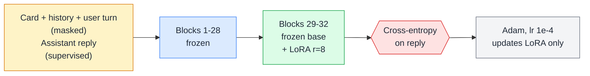
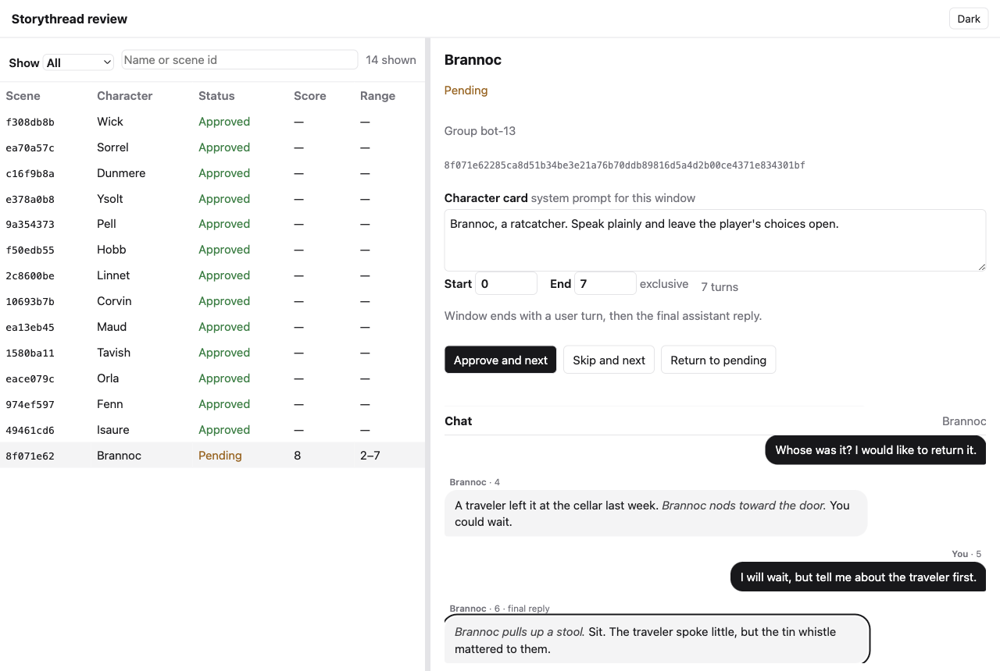

# Storythread continuity adapter

**Research question:** can a small QLoRA adapter improve roleplay continuity by
training on replies that depend on earlier scenes?

The target experience is a character who is engaging to talk to, remembers what
happened, and gives the player room to act. The character card guides genre,
voice, and prose style.

## Training picture

Both arms run the same QLoRA recipe on a frozen 4-bit Qwen3.5-4B
(`mlx-community/Qwen3.5-4B-4bit`, 4-bit affine, group size 64). `mlx_lm.lora`
trains low-rank adapters on the last four of the 32 blocks. The arms differ
only in which authored reply they supervise.

**Legend:** amber is data, blue is frozen weights, green is trainable LoRA
weights, red is the loss, indigo is a saved adapter, gray is a process step.


One training update, identical for both arms:



On every linear inside blocks 29–32 the forward pass is

`y = W4(x) + 2 · (x A) B`

with `A` shaped `in × 8`, `B` shaped `8 × out`, and `B` initialized at zero.
Dropout is 0. `W4` stays quantized and frozen. Trainable weights are `A` and
`B` only.


Blocks 29–31 adapt the Gated DeltaNet linears `in_proj_qkv`, `in_proj_z`,
`in_proj_a`, `in_proj_b`, and `out_proj`, plus the MLP `gate_proj`, `up_proj`,
and `down_proj`. Block 32 adapts `q_proj`, `k_proj`, `v_proj`, and `o_proj`,
plus the same MLP. `q_proj` is twice a normal query width because it also
emits the attention output gate. The depthwise `conv1d`, RMSNorms, `A_log`,
`dt_bias`, embeddings, and the tied head stay frozen.

Status: the data, preflight, and scoring tooling is verified on a synthetic
fixture. **Every experimental result below is pending until measured.**

Run every command from the repository root (this directory) inside a virtualenv.

## 0. Setup

```bash
python3 -m venv .venv && source .venv/bin/activate
pip install "mlx-lm==0.32.2" huggingface_hub transformers pyyaml
python -m unittest discover tests        # fixture end-to-end check, no GPU needed
python -m storythread.runtime setup-model            # freezes models/qwen35-4b-q4 (records revision)
```

The scripts live in the `storythread/` package. Run each from the repository
root as `python -m storythread.<name>` (`data`, `judge`, `runtime`, `eval`,
`review_ui`); `export`, `scenarios`, and `splits` are helpers. Configs
(`pilot.yaml`, `smoke.yaml`), `fixtures/`, and `tests/` stay at the root.

`data.py`, `review_ui.py`, `eval.py` (except `generate`), and the tests use
only the standard library. `mlx-lm` 0.32.2 is the version this guide was
checked against.

## 1. Experiment design

Two training arms share the **same curated PIPPA core** and the same authored
scenarios. They differ only in which branch of each authored scene pair they
train on:

| Arm | Authored branch | Reply depends on |
|---|---|---|
| `recent` | `branches.recent` | evidence in the last few turns |
| `earlier` | `branches.earlier` | evidence far back in the history |

Authored examples start at about 25% of each arm (`--authored-share 0.25`), the
PIPPA core is subsampled deterministically to match, and both arms have equal
example counts, row order, model revision, rank, adapted blocks, learning rate,
and update count. Loss is on the final assistant reply only
(`mask_prompt: true`).

Evaluation compares untuned 4B (`base`), the `recent` adapter, and the
`earlier` adapter on the same fixed histories, cards, and generation settings.
Retrieval is out of scope: each prompt contains the evidence turn directly.

## 2. Curate PIPPA

PIPPA contains mature and disturbing content. You decide what is approved.

```bash
hf download PygmalionAI/PIPPA pippa_deduped.jsonl --repo-type dataset --local-dir work/pippa
python -m storythread.data index work/pippa/pippa_deduped.jsonl work/index.jsonl
python -m storythread.data review work/index.jsonl work/review.jsonl --sample 300
python -m storythread.data show work/index.jsonl <scene_id>        # read a scene by turn number
```

Indexing is broad by default. `--pattern REGEX` and `--tag fantasy|romance`
(repeatable) are optional search aids that narrow the index and fill `tags`.

### Optional: local judge triage

`judge.py` triages each review row with a local Ollama model. It cuts the log
into a BEGINNING and an ENDING excerpt (about 7,000 characters each) and asks
for a memory check, a mechanics/anti-slop check, and a lorebook summary of the
BEGINNING in one JSON reply. A log is `passed` only if `memory_score >= 4`,
`quality_score >= 4`, and `god_moding`, `ooc_or_refusal` and `repetitive_slop`
are all false; otherwise it is `rejected` with `reject_reasons`.

It also keeps the 0-2 rubric (`responsiveness`, `character_consistency`,
`player_agency`, `story_progression`, summed into `total`, plus `keep_reason`
and `concern`) as the standard for comparing judges. The rubric scores the
final reply of the row's own `start`/`end` window and never rejects. A row
without a valid window (`invalid_range`, `bad_final_roles`) is recorded as
`failed` without a model call; fix the window and run again. Dark and adult
themes are never rejected or scored down: they set `mature_content` and add a
`mature_content` flag so you can check those scenes by hand.

It only writes
`work/review_triage.jsonl` and `work/review_triage.csv`. It never touches
`work/review.jsonl`: you still set `approved`, `start`/`end`, and `system` by
hand. It does not suggest ranges. Read the limitations at the top of
`judge.py`: a small model's scores are noisy and unvalidated, so check
`reject_reasons` and `contradictions` before discarding a scene.

```bash
ollama pull qwen3.5:4b   # once; the Ollama server must be running
python -m storythread.judge --limit 20
```

That judges the next 20 rows of `work/review.jsonl` (about 12 s per scene on
Apple Silicon). Run the same command again for the next batch: scenes already
in `work/review_triage.jsonl` are skipped, so no copying or offsets are
needed. A scene counts as judged once it has a `passed` or `rejected` row from
the same `--model`; `failed` rows are judged again. Every row records its
`judge_model`, and a different `--model` judges the scene again without
replacing the first judge's row, so the CSV holds one row per scene and model
for side-by-side comparison. The JSONL is only appended to; the CSV is rebuilt
from it every run, so keep notes elsewhere. To start over, delete the two
output files.

To use another model, pull it and pass its Ollama name: `ollama pull <name>`,
then `python -m storythread.judge --model <name>`. Use `--endpoint` for an Ollama server on
another machine. The model must support Ollama structured outputs. The script
speaks only Ollama's `/api/chat`, so hosted models (Claude, GPT) are not
supported.

Options: `--model` (default `qwen3.5:4b`), `--endpoint`
(`http://127.0.0.1:11434`), `--max-tokens` (training cap used for flagging,
default 1024), `--limit` (next unjudged rows, default 20, `0` = all), `--num-ctx`
(judge context, default 8192; 4096 truncates the prompt), `--retries` (extra
tries when the model's JSON is invalid, default 2), and `--output`/`--csv`.
The judge runs at temperature 0.1 and never sees the `system` card. The
`lorebook_summary` is saved in both files. `tokens` counts the window already
in the review row with its `system` card as of the judging run; to re-count
after editing a card, delete that scene's row from the JSONL and rerun.

Each request sends one card and its turns as JSON-escaped data, with a system
prompt that tells the model to ignore instructions inside them. Long scenes show
only the newest turns that fit `--num-ctx`; `shown_from` records the first turn
shown. The model names the turn of the final reply (`reply_turn`) and `start`;
Python sets `end = reply_turn + 1` (exclusive, as in `review.jsonl`), checks the
range, totals the four scores (0-8), and counts tokens of the full example using
the row's current `system` card with the same logic as `runtime.py check-data`.

| `status` | Meaning |
|---|---|
| `proposed` | The model suggested a range. Check `flags`. |
| `skipped` | The model deliberately found no good target; see `skip_reason`. |
| `failed` | The call or its output was unusable (`error`); not a judgment. |

`flags` keep problem rows visible instead of dropping them: `invalid_range`
(out of bounds or under two turns), `bad_final_roles` (not user then assistant),
`target_truncated` (full example over `--max-tokens`; same flag as `check-data`),
`invalid_scores`, `prompt_truncated` (the scene filled `--num-ctx`), and
`empty_card`.

Sort the CSV by `total` after filtering out rows with `flags`. Treat scores as a
rough ordering: a 4B judge gives similar totals to most scenes, so read the
`rationale` (one reason to keep, one concern) before approving. The judge may
also skip mature scenes on its own content policy, which the rubric does not ask
for; check `skip_reason` before trusting a skip.

### Local review UI

`review_ui.py` serves one page for these decisions, on localhost:

```bash
python -m storythread.review_ui
```

Open http://127.0.0.1:8765/. Paths default to `work/review.jsonl`,
`work/index.jsonl`, and `work/review_suggestions.jsonl`. `--port` changes
8765.



The queue opens on pending rows. Click a column heading to sort. Names come
from the index. When the suggestions file has that scene, the row shows the
latest scored total and its suggested `start`/`end`.

Each scene has its own page, `/scene/<scene_id>`. Click a scene id to open
it; back returns to the queue. Edit `system`, `start`, and `end`
(`end` is exclusive). Turns in the window are highlighted, and the window's
last assistant turn is labeled as the final reply. Then use **Approve and
next**, **Skip and next**, or **Return to pending**.

`review_status` is `pending`, `skipped`, or `approved`. The `approved`
boolean stays, and the page sets it to true only for `approved`. A row with
no `review_status` shows as Approved when `approved` is true and Pending
otherwise. Approve refuses a window that is out of bounds or does not end
with a user turn followed by an assistant reply. Each action replaces
`work/review.jsonl` atomically and keeps every other row and field.
`data.py prepare` still keeps a scene only when `approved` is true.

Approve scenes with:

- coherent exchanges (no broken or repeated turns);
- responsive characters that answer what the player just did or said;
- player agency (the character does not decide the player's actions or
  feelings);
- earlier details that later turns could plausibly depend on.

`group` defaults to the PIPPA `bot_id`. Give related cards (same character,
sequels, shared world) the same `group` to keep them in one split.

## 3. Author scene pairs

Write original scenes to `authored/scenes.jsonl` (see the schema below). Each
scenario has one shared history and two final turns: one reply depends on
recent evidence, the other on earlier evidence. `earlier` must be farther from
the reply than `recent`. `evidence` is a quote that must appear in the cited
turn.

`authored/scenes.jsonl` is sized for a 16 GB Mac: every scene fits 512 tokens
(see step 6). `authored/scenes-long.jsonl` keeps the original longer scenes
(up to about 1,450 tokens, evidence up to 27 turns back) for machines with more
memory. Pass it to `prepare` and to `author_ui --scenes` there.

### Local authoring UI

`author_ui.py` serves one page for writing these scenes, on localhost:

```bash
python -m storythread.author_ui
```

Open http://127.0.0.1:8766/. The file defaults to `authored/scenes.jsonl`.
`--port` changes 8766. The first page lists saved scenes. **Delete** on a
row asks you to confirm in a dialog, then removes that scene. **New scene**
opens an editor with a generated `scenario_id`. Click a chat bubble to edit it in
the sidebar, and highlight words in a turn to use them as evidence. Checks run
when you press Save.

## 4. Export the two datasets

```bash
python -m storythread.data prepare work/pippa/pippa_deduped.jsonl work/review.jsonl \
  authored/scenes.jsonl work/datasets --valid-share 0.1 --authored-share 0.25
```

Splits are assigned per linked group: a scenario, its branches, cards with the
same `group`, cards with the same PIPPA `bot_id`, and identical windows always
land in the same split. Each source (PIPPA, authored) contributes about
`--valid-share` of its items to `valid`. `summary.json` lists counts, the actual
authored share, and any shortage of core examples.

## 5. Tokenizer preflight and the sequence cap

```bash
python -m storythread.runtime check-data --data work/datasets/recent --max-tokens 512 --report-only
python -m storythread.runtime check-data --data work/datasets/earlier --max-tokens 512 --report-only
```

Reports input, target-reply, and full-example token counts, and (for authored
rows) evidence distance in turns and in templated tokens, per source and
branch. It also verifies the final-reply mask aligns with the chat template.
Rows are flagged when they would lose their target reply (`target_truncated`;
mlx-lm truncates from the end), lose their evidence (`evidence_truncated`), or
have a misaligned mask or empty target. Without `--report-only` the command
exits non-zero if any row is flagged. Evidence offsets are approximate to a few
template tokens. Fix flagged rows by shortening review windows or authored
histories.

## 6. Smoke test and memory probes (16 GB Mac)

Smoke test (tiny `smoke-data/`, 512 tokens, 10 updates):

```bash
mkdir -p runs
python -m storythread.runtime check-data --data smoke-data --max-tokens 512
python -m storythread.runtime train -- --config smoke.yaml
```

`runtime.py train` runs `mlx_lm.lora` unchanged and also writes
`<adapter_path>/train_metrics.json` (mean and max step time, peak memory in GB).

Probe real long examples at each candidate cap. Close other apps first:

```bash
for CAP in 1024 2048; do
  python -m storythread.runtime probe --data work/datasets/recent --target-tokens $CAP \
    --count 4 --output work/probe-$CAP
  python -m storythread.runtime train -- --config smoke.yaml --data work/probe-$CAP \
    --max-seq-length $CAP --iters 5 --adapter-path runs/probe-$CAP
  cat runs/probe-$CAP/train_metrics.json
done
```

`probe` picks the longest training examples that fit under the target and
refuses if none reach 60% of it (author a longer scene instead).

Choose **one cap** for both arms: the largest of 512, 1024, 2048 whose probe
finishes with comfortable memory headroom, and for which `check-data` reports
zero flagged rows in both arms at that cap.

## 7. Pilot runs

Identical settings except the data and output directory (`pilot.yaml`: seed 42,
LoRA rank 8, 4 adapted blocks, learning rate 1e-4, 100 updates):

```bash
CAP=1024   # the verified cap from step 6
for ARM in recent earlier; do
  python -m storythread.runtime check-data --data work/datasets/$ARM --max-tokens $CAP
  python -m storythread.runtime train -- --config pilot.yaml --data work/datasets/$ARM \
    --adapter-path runs/pilot-$ARM --max-seq-length $CAP
done
```

Step time and peak memory land in `runs/pilot-<arm>/train_metrics.json`. The
model revision is in `models/qwen35-4b-q4/source.json`. Both arms see the same
row order and seed.

### Inspect the adapters

```bash
python -m storythread.inspect_adapters --recent runs/pilot-recent \
  --earlier runs/pilot-earlier --output work/adapter_heatmap.html
```

Writes one standalone HTML file (open it in a browser; no server needed). It
reads the saved LoRA files directly, so Qwen is not loaded. Needs `numpy`,
which `transformers` installs.

- Snapshots (`0000025_adapters.safetensors`, ...) are matched across the two
  runs by optimizer step; steps missing from either run are listed. The final
  `adapters.safetensors` is shown once when it duplicates the last snapshot.
- The scale comes from each run's `adapter_config.json`.
- **Effective LoRA update RMS** is `|scale| * ||A @ B||_F / sqrt(in * out)`
  for each projection, computed from rank-by-rank Gram matrices. It measures
  update size only. How much an update changes behavior is a separate
  question for ablation.
- Rows are blocks and columns are projections, with one color scale for both
  arms and every step. Blank cells have no adapter tensor. Click a cell for
  its module path, dimensions, rank, and RMS per arm, plus its RMS across the
  saved steps.

## 8. Evaluate

Author held-out scenarios in `eval/dev.jsonl` and `eval/test.jsonl` with
original characters and histories. Keep the test set frozen: tune on dev only.
Each scenario has two versions where one earlier event differs, the final user
prompt is identical, and the expected reply changes.

```bash
python -m storythread.eval validate eval/dev.jsonl eval/test.jsonl   # schema + dev/test disjoint
mkdir -p work/eval
python -m storythread.eval generate --label base eval/test.jsonl work/eval/base.jsonl
python -m storythread.eval generate --label recent --adapter runs/pilot-recent \
  eval/test.jsonl work/eval/recent.jsonl
python -m storythread.eval generate --label earlier --adapter runs/pilot-earlier \
  eval/test.jsonl work/eval/earlier.jsonl
```

Greedy decoding, same `--max-tokens`, same prompts (checked by prompt hash).
Output rows record the case-file hash so the frozen test set is verifiable.

**Primary metric: continuity.** Percent of scenarios where the model acts on the
correct story state in both versions.

```bash
python -m storythread.eval sheet eval/test.jsonl work/eval/sheet.jsonl work/eval/key.jsonl \
  --outputs work/eval/base.jsonl work/eval/recent.jsonl work/eval/earlier.jsonl
# Reviewer: in sheet.jsonl set "satisfies": true/false on every reply, judging
# it against "expected" and "evidence". In-character paraphrases count.
python -m storythread.eval continuity eval/test.jsonl work/eval/sheet.jsonl work/eval/key.jsonl \
  > work/eval/continuity.json
```

Replies are shuffled per case and labeled `R1..R3`; the key is separate. The
report gives, per condition, counts with denominators for both versions
satisfied, for single versions, and for each evidence-distance bucket
(`--edges 4,12` turns by default).

**Separate score: engagement.** Blind pairwise, question: "Which character would
you rather keep chatting with?"

```bash
python -m storythread.eval blind eval/test.jsonl work/eval/base.jsonl work/eval/recent.jsonl \
  work/eval/blind-base-recent.jsonl work/eval/blind-base-recent-key.jsonl
# Reviewer: set "winner" to A, B, or tie. Repeat for base/earlier, recent/earlier.
python -m storythread.eval score work/eval/blind-base-recent.jsonl work/eval/blind-base-recent-key.jsonl
```

## 9. Schemas and outputs

All files are JSONL.

**PIPPA source** (`pippa_deduped.jsonl`): uses `bot_id`, `bot_name`,
`bot_description`, `bot_greeting`, and `conversation[{message, is_human}]`.

**Index** (`work/index.jsonl`): `scene_id`, `suggested_group`, `tags`, `name`,
`description`, `bot_id`, `turns[{role, content}]`.

**Review** (`work/review.jsonl`): `scene_id`, `approved` (bool), `group`,
`start`, `end`, `system`; optional `tags`, `bot_id`, and `review_status`
(`pending`, `skipped`, or `approved`). The review page sets `approved` to
true only when `review_status` is `approved`.

**Authored scenes** (`authored/scenes.jsonl`):

```json
{"scenario_id": "salt-river", "group": "tamsin", "system": "Card text.",
 "history": [{"role": "assistant", "content": "..."}, {"role": "user", "content": "..."}],
 "branches": {
   "recent":  {"user": "...", "reply": "...", "evidence_turn": 6, "evidence": "quote"},
   "earlier": {"user": "...", "reply": "...", "evidence_turn": 1, "evidence": "quote"}}}
```

`history` alternates roles and ends with an assistant turn. `evidence_turn`
indexes conversation turns (system card excluded; the branch's own `user` turn
is `len(history)`). Evidence distance = index of the target reply minus
`evidence_turn`.

**Eval scenarios** (`eval/dev.jsonl`, `eval/test.jsonl`):

```json
{"scenario_id": "test-oven", "group": "perrin",
 "versions": {
   "a": {"messages": [{"role": "system", "content": "..."}, "...", {"role": "user", "content": "..."}],
         "expected": "Recommends a loaf without wheat.", "evidence_turn": 2, "evidence": "wheat"},
   "b": {"messages": ["same system and final user turn; evidence turn differs"],
         "expected": "...", "evidence_turn": 2, "evidence": "nuts"}}}
```

`evidence_turn` indexes turns after the system card. Both versions must cite the
same turn, differ there, and share the system card and final user prompt.

| Output | Location |
|---|---|
| Index, review template | `work/index.jsonl`, `work/review.jsonl` |
| Judge triage (advisory) and sortable CSV | `work/review_triage.{jsonl,csv}` |
| Arm datasets | `work/datasets/{recent,earlier}/{train,valid}.jsonl` |
| Review manifest (source, group, split, `row`, `branch`, `evidence_turn`, `evidence_distance_turns`, window) | `work/datasets/<arm>/manifest.jsonl` |
| Export counts, authored share, core hash | `work/datasets/summary.json` |
| Preflight report | `work/datasets/<arm>/preflight-<cap>.json` |
| Adapters, step time, peak memory | `runs/pilot-<arm>/` (`train_metrics.json`) |
| Generations | `work/eval/<label>.jsonl` |
| Rating sheet and key | `work/eval/sheet.jsonl`, `work/eval/key.jsonl` |
| Continuity report | `work/eval/continuity.json` |
| Engagement sheets and keys | `work/eval/blind-*.jsonl` |

`work/`, `runs/`, `models/`, downloaded PIPPA files, `private/`, and
`transcripts/` are ignored by Git.

## 10. Fixture and verification

`fixtures/` is a synthetic, original dataset: PIPPA-shaped sample, review file,
four authored scenes, and separate dev and test eval sets. Run it:

```bash
python -m unittest discover tests
python -m storythread.data prepare fixtures/pippa-sample.jsonl fixtures/review.jsonl \
  fixtures/authored.jsonl /tmp/fixture-datasets --valid-share 0.25 --seed 3
python -m storythread.eval validate fixtures/eval-dev.jsonl fixtures/eval-test.jsonl
```

The tests cover export, preflight, sheet generation, scoring, the local
review page, and the local authoring page. Model generation is replaced by
synthetic outputs, and reviewer ratings are scripted.

| Check | Status |
|---|---|
| Export: shared core, equal counts, 25% authored, split integrity, manifest evidence/branch | Verified on fixture |
| Review UI: decision survives reload; prepare still reads `approved` | Verified on fixture |
| Author UI: a scene saved in the editor exports into both arms | Verified on fixture |
| Preflight measurement and flags (fake tokenizer in tests; Qwen3.5-4B tokenizer and chat template checked by hand on the fixture export) | Verified |
| Eval validation, blind sheet, continuity scoring with distance buckets, engagement scoring | Verified on fixture |
| 512-token smoke run (`runtime.py train -- --config smoke.yaml`) | Needs local Apple Silicon run |
| 1,024 and 2,048 probes, peak memory on 16 GB | Needs local Apple Silicon run |
| `runtime.py train` metrics hook (`train_metrics.json`) during real training | Needs local Apple Silicon run |
| `eval.py generate` with the 4-bit model and adapters | Needs local Apple Silicon run |
| Pilot runs, continuity, engagement | Pending, not measured |

## 11. Results (pending)

| Condition | Both versions correct | Engagement wins | Step time (s) | Peak mem (GB) |
|---|---|---|---|---|
| base | pending | pending | n/a | n/a |
| recent adapter | pending | pending | pending | pending |
| earlier adapter | pending | pending | pending | pending |

## 12. Follow-up: SillyTavern retrieval test

Not part of the main evaluation. After the above, load the same characters and
histories in SillyTavern with its memory/vector retrieval enabled (no evidence
in the prompt window), and run the same scenarios on base and each adapter.
Record the retrieval settings, and score with the same continuity sheet.

## Credits

- **REMP** (Yu et al., *REMP: A Structured Event-Probing Benchmark for
  Long-Horizon Role-Playing Dialogue*, Findings of EMNLP 2026) inspired the
  event-triggered evaluation design: probe the model after a diagnostic event
  and compare against a reference. This repository uses a much smaller,
  independent protocol; its numbers are not comparable to REMP's.
  [Paper](https://aclanthology.org/2026.findings-emnlp.602/)
- [PIPPA](https://huggingface.co/datasets/PygmalionAI/PIPPA) (Gosling, Dale,
  Zheng) supplies the curated roleplay core.
- The recent-versus-earlier training comparison is Storythread's own experiment,
  separate from REMP.
